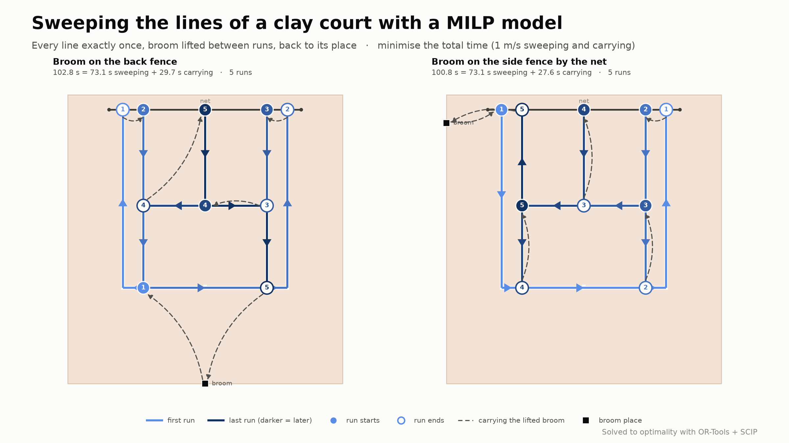

# Tennis Line Sweeping

[](https://colab.research.google.com/github/tbulubas/tennis-line-sweeping/blob/main/notebooks/line_sweeping.ipynb)

The lines of a clay tennis court have to be swept clean with a line broom.
The broom is kept somewhere by the fence. Starting there, all lines of one
half of the court, doubles lines included, are swept exactly once in runs;
between runs the broom is lifted and carried to the start of the next run,
and at the end it goes back to its place. The goal is the shortest total
time.

The problem is solved with a mixed-integer model that combines

1. a **direction** for every piece of line (binary),
2. the **carries** of the lifted broom between stop points (binary), and
3. **balance** at every stop point, which makes sweeps and carries one
   Euler circuit through the broom place.

- Problem statement: [docs/problem-statement.md](docs/problem-statement.md)
- Mathematical model: [docs/mip-model.md](docs/mip-model.md)

## Author

**Taras Bulubas** — taras.bulubas@gmail.com

All work on this project was done on my own hardware and in my private time.
All new and original ideas in it — the problem, the modelling approach and
its formulation — are my own and the result of many years of work in
optimisation, operations research and algorithms.

**Use of AI.** Claude (an AI assistant by Anthropic) was used to help write
the code and the documentation, following my specifications and decisions.

**License.** © 2026 Taras Bulubas. All rights reserved. This repository is
published for viewing only; any use requires my prior written permission —
see [License](#license). The one exception is the notebook, which you may run
and modify in Google Colab for personal, non-commercial exploration.

## Development environment

Requires Python 3.12 and GNU make 3.82+. The solver is SCIP, shipped with
OR-Tools, so nothing else has to be installed.

All dependencies are declared in [pyproject.toml](pyproject.toml):

| Group            | Packages     | Used for                    |
|------------------|--------------|-----------------------------|
| runtime          | `ortools`    | the MILP model and SCIP     |
| extra `dev`      | `pytest`     | tests                       |
| extra `plot`     | `matplotlib` | the court drawings          |
| extra `notebook` | `jupyterlab`, `ipywidgets`, `pandas` (+ `plot`) | the interactive notebook |

### Getting make on Windows

make is not part of Windows. Install it once, e.g. with

```bash
winget install ezwinports.make
```

or `choco install make` (from an administrator shell). Open a new terminal
afterwards so that `make` is on the `PATH`.

### Make targets

```bash
make venv
```

creates `.venv` with **Python 3.12** and installs the project in editable
mode with the `dev`, `plot` and `notebook` extras. Running it again only reinstalls when
`pyproject.toml` or the `Makefile` has changed.

The version is pinned in the Makefile (`PYTHON_VERSION := 3.12`). On Windows
the base interpreter is found with the py launcher (`py -3.12`), elsewhere as
`python3.12`, so it does not matter which `python` comes first on the `PATH`.
If `.venv` exists with another Python version, `make venv` stops and asks for
`make recreate`. To move the project to another version, change
`PYTHON_VERSION` and run `make recreate`.

| Target           | What it does                                                       |
|------------------|--------------------------------------------------------------------|
| `make` / `make help` | list the targets                                               |
| `make venv`      | create `.venv` and install the project with all extras             |
| `make test`      | run the tests with pytest                                          |
| `make run`       | solve the example instance; another broom place with `ARGS="-x -3.66 -y 11"` |
| `make image`     | render `images/line-sweeping-linkedin.png`                         |
| `make notebook`  | open `notebooks/line_sweeping.ipynb` in JupyterLab                 |
| `make notebook-check` | run all notebook cells headless and store the outputs         |
| `make clean`     | remove caches and build metadata                                   |
| `make distclean` | `clean` and remove `.venv`                                         |
| `make recreate`  | `distclean`, then `venv` — a fresh environment                     |

`test`, `run`, `image` and `notebook` create the environment first if it does not exist.
The Makefile works from PowerShell, cmd and Git Bash on Windows as well as on
Linux/macOS.

### Without make

```bash
py -3.12 -m venv .venv
.venv/Scripts/python -m pip install -e ".[dev,plot,notebook]"
```

(On Linux/macOS use `python3.12 -m venv .venv` and `.venv/bin/python`.)

### IntelliJ IDEA

See [docs/intellij.md](docs/intellij.md): register `.venv` as the project
interpreter and use the shared run configurations in `.run/` to run the
tests, the application and the image script.

## Notebook

[notebooks/line_sweeping.ipynb](notebooks/line_sweeping.ipynb) is a
self-contained walk-through: it explains the problem and the model, lets you
place the broom and set the speeds, solves the model and draws the route with
a step-by-step table, an independent check of optimality and the model size.
An interactive explorer with sliders and a *Solve* button closes it.

**Online, nothing to install:** [](https://colab.research.google.com/github/tbulubas/tennis-line-sweeping/blob/main/notebooks/line_sweeping.ipynb)

The link opens the notebook in Google Colab (a Google account is needed).
Its first code cell installs the model package from this repository; then
*Runtime → Run all* runs everything. Changes stay in your own copy — use
*File → Save a copy in Drive* to keep them.

**Locally:**

```bash
make notebook
```

opens it in JupyterLab in the browser. The notebook is stored with the
outputs of the default instance, so it can also be read without running it.

## Usage

```bash
make run
```

which runs `python -m line_sweeping -x 5.485 -y -6.4` in `.venv` — the broom
on the back fence, behind the centre mark:

```
status: optimal
total time: 102.82 s = sweeping 73.14 s + carrying 29.68 s
distance: sweeping 73.14 m, carrying 29.68 m; 5 runs (at least 5)
  carry  (5.485, -6.400) → (1.370, 0.000)     7.609 m
run 1:
  sweep  (1.370, 0.000) → (0.000, 0.000)     1.370 m   baseline
  sweep  (0.000, 0.000) → (0.000, 11.885)    11.885 m   left doubles sideline
  carry  (0.000, 11.885) → (1.370, 11.885)     1.370 m
run 2:
  …
check: OK
```

Positions are in metres in court coordinates: the origin is the left end of
the baseline seen from behind it, x runs along the baseline to the right, y
towards the net (at 11.885). Options: `-x`/`-y` broom place,
`--sweep-speed` and `--carry-speed` in m/s (default 1), `--centre-mark` to
sweep the centre mark as a line of its own instead of together with the
baseline, `--time-limit` seconds for the solver.

From Python:

```python
from line_sweeping import SweepInstance, solve, verify

instance = SweepInstance(broom=(-3.66, 11.0), sweep_speed=1.0, carry_speed=1.0)
plan = solve(instance)
print(plan.objective, len(plan.runs), plan.carry_distance)
assert verify(instance, plan) == []
```

`verify` checks a route against the rules using positions and the painted
lines only, independently of the model.

## Image



```bash
make image
```

The script solves both instances, checks the routes with `verify` and writes
`images/line-sweeping-linkedin.png` (2400 × 1350 px).

## Tests

```bash
make test
```

Besides the rules, the tests compare the MILP optimum with an exact optimum
computed independently (a minimum matching of the vertices of odd degree).

## Layout

```
docs/                 problem statement, mathematical model, IntelliJ setup
src/line_sweeping/
  court.py            ITF court dimensions, lines of one half, line graph
  instance.py         input parameters
  model.py            OR-Tools / SCIP model, solve and the Euler route
  solution.py         SweepPlan, route_time and the independent verify()
  cli.py              command line interface
  draw.py             top view of the court with the route
scripts/              linkedin_image.py renders the image, check_venv.py guards the Python version
tests/                examples from docs/mip-model.md, independent optimum, edge cases
notebooks/            interactive notebook
.run/                 shared IntelliJ run configurations
Makefile              environment and task shortcuts
LICENSE               all rights reserved
```

## License

© 2026 Taras Bulubas. **All rights reserved.**

This repository — code, models, documentation, notebooks and images — is
published for viewing only. Using, running, copying, modifying or
distributing any part of it requires my prior written permission.

**Exception:** you may open, run and modify the notebook
`notebooks/line_sweeping.ipynb` in Google Colab for personal, non-commercial
exploration. Your modified copy is for yourself only; it may not be published
or redistributed, and the code and models may not be reused elsewhere.

See [LICENSE](LICENSE) for the full terms. To ask for permission, write to
taras.bulubas@gmail.com.
